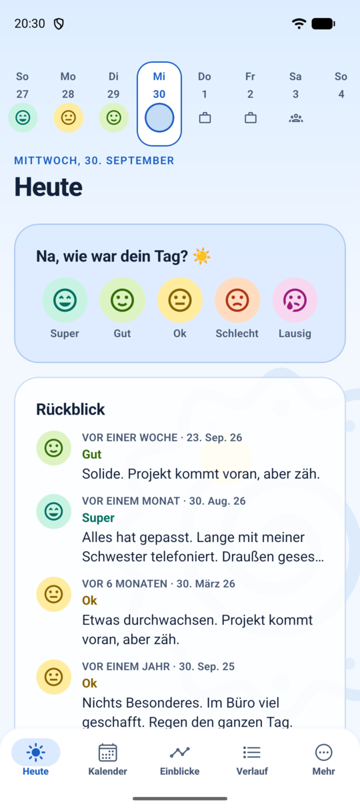
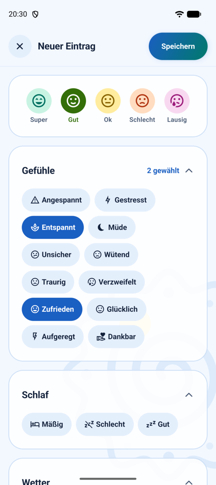
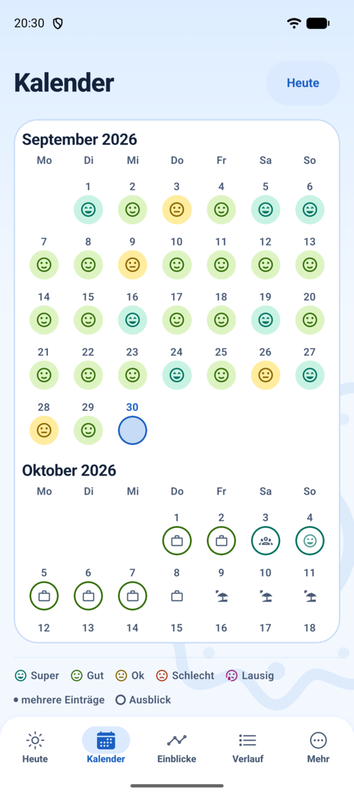
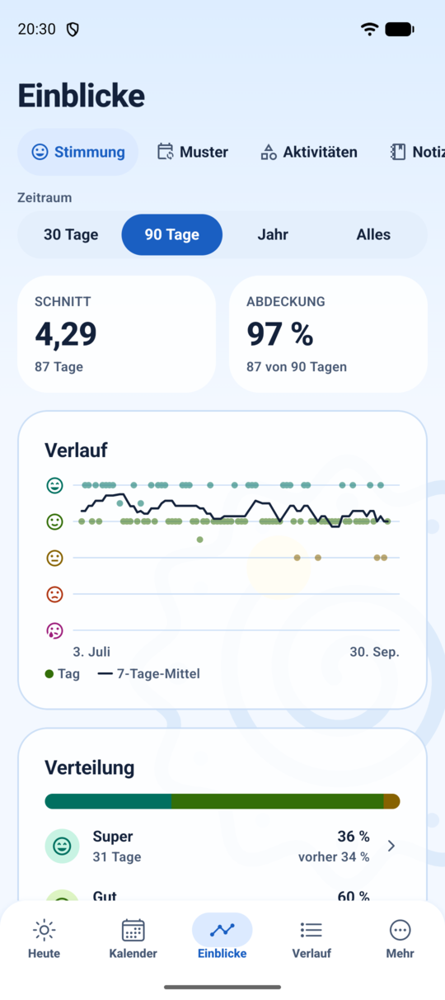
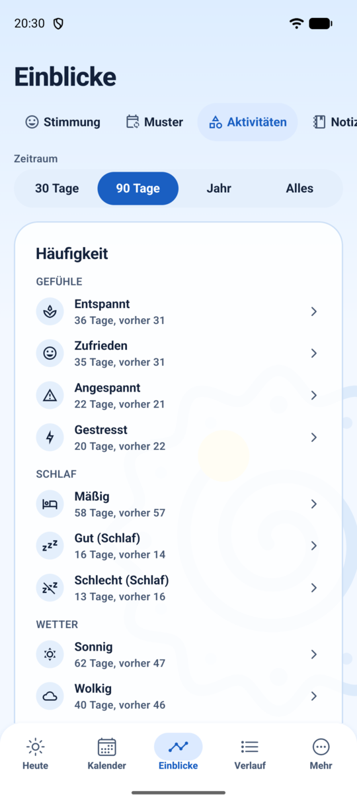
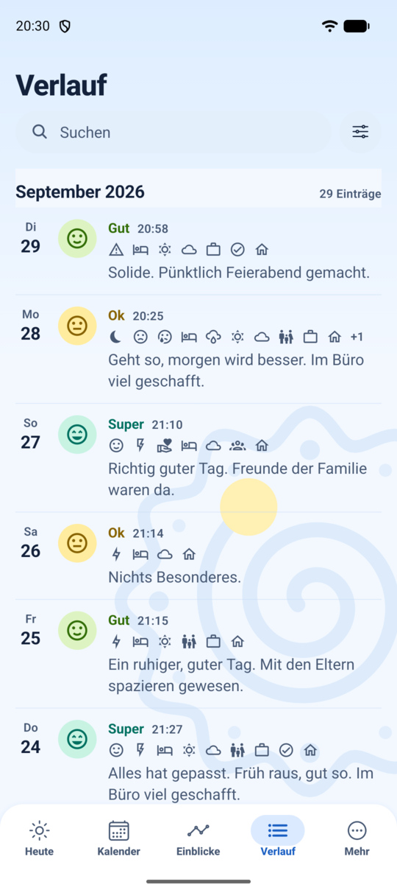
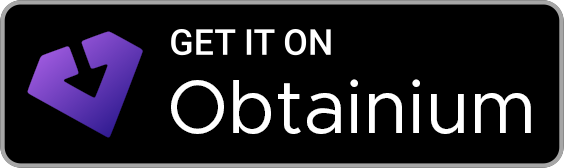

# Daylight

[English](README.md) | **Deutsch**

Ein Stimmungstagebuch für Android, das deine Daten nicht kennt. Keine Konten, keine Server, keine Analytics, keine Werbung und keine Internet-Berechtigung. Alles bleibt auf deinem Gerät.

<p align="center">
  
  
  
</p>
<p align="center">
  
  
  
</p>

<sub>Alle Screenshots zeigen die eingebauten Beispieldaten.</sub>

## Highlights

- 🔒 **Komplett offline.** Daylight hat keine Internet-Berechtigung. Deine Einträge liegen in einer Datenbank auf dem Gerät und verlassen es nur, wenn du selbst eine Sicherung teilst. Der [Bericht von Exodus Privacy](https://reports.exodus-privacy.eu.org/de/reports/de.behla.daylight/latest/) findet in der Play-Version keinen Tracker.
- ⚡ **In Sekunden eingetragen.** Stimmung antippen, Aktivitäten wählen, fertig. Notiz, eigene Skalen und ein Foto pro Tag sind optional.
- 📦 **Einfacher Umstieg.** Daylight übernimmt ein bestehendes Stimmungstagebuch aus einer anderen App vollständig, als CSV-Export oder als Sicherung mit Fotos. Exportieren kannst du auch wieder als CSV, und für Arzt oder Therapie gibt es einen Bericht als PDF mit Verlauf, Schlaf, Skalen und Aktivitäten, auf dem Gerät erstellt.
- 📊 **Einblicke in deine Muster.** Verlauf, Wochentage, Monate, Jahr in Pixeln, welche Aktivitäten mit besseren oder schlechteren Tagen zusammenfallen, was am Folgetag passiert, häufige Wörter in deinen Notizen. Immer als Beschreibung deiner Einträge, nie als Diagnose.
- 🌅 **Wendepunkte.** Tage markieren, die etwas verändert haben, etwa ein neuer Job oder ein Umzug, und die Zeit davor mit der Zeit danach vergleichen.
- 🧪 **Experimente.** Dir für ein paar Wochen etwas vornehmen, etwa kein Kaffee nach 14 Uhr, und deine Einträge davor und währenddessen nebeneinander sehen. Daylight sagt ehrlich, wenn die Tage nicht reichen oder der Unterschied im Rahmen deiner üblichen Schwankungen liegt.
- 🏆 **Erfolge fürs Dranbleiben.** Sterne für Tage und Wochen am Stück, für Notizen, Fotos, Aktivitäten, Schlaf und Schritte. Belohnt wird nur das Festhalten, nie wie ein Tag war.
- 🔭 **Ein ehrlicher Ausblick.** Daylight schätzt die nächsten sieben Tage, aber nur dort, wo das auf deinen eigenen Daten nachweislich besser funktioniert als simples Raten. Sonst tritt der Ausblick zurück und sagt das auch.
- ❤️ **Gesundheitsdaten, wenn du willst.** Schritte, Schlaf, Ruhepuls und Training aus Health Connect, etwa von einer Smartwatch. Nur lesend und nur nach deiner Zustimmung.
- 🌙 **Dunkles Design für den Abend.** Ein nachtblaues Farbschema, das dem Handy folgt oder fest hell oder dunkel bleibt, mit Stimmungsfarben und Jahr in Pixeln, die auf dunklem Grund gut lesbar sind. Die Designs zur Jahreszeit kommen mit.
- 🛡️ **Geschützt.** App-Sperre über die Displaysperre des Geräts, keine Screenshots bei aktiver Sperre, kein Android-Cloud-Backup. Eine Erinnerung am Abend verrät im Text nichts aus dem Tagebuch.

Die Oberfläche gibt es auf Deutsch, Englisch, Spanisch, Portugiesisch (Brasilien), Französisch, Italienisch, Niederländisch, Polnisch, Türkisch und Indonesisch.

## Installieren

Am einfachsten über [Google Play](https://play.google.com/store/apps/details?id=de.behla.daylight).

Ohne Google-Konto geht es mit der APK, die bei jedem [Release](https://github.com/Jurgler95/daylight/releases/latest) liegt. Auf dem Handy herunterladen und öffnen; Android fragt einmalig, ob der Browser Apps installieren darf. Play-Version und APK sind mit demselben Schlüssel signiert und lassen sich übereinander installieren.

Wer die APK automatisch aktuell halten will, holt sie über [Obtainium](https://github.com/ImranR98/Obtainium) direkt aus den Releases:

[](https://apps.obtainium.imranr.dev/redirect?r=obtainium://app/%7B%22id%22%3A%22de.behla.daylight%22%2C%22url%22%3A%22https%3A%2F%2Fgithub.com%2FJurgler95%2Fdaylight%22%2C%22author%22%3A%22Paul%20Behla%22%2C%22name%22%3A%22Daylight%22%7D)

Jede APK ist mit demselben Schlüssel signiert. Wer das prüfen will, vergleicht den SHA-256-Fingerabdruck des Zertifikats (`apksigner verify --print-certs daylight-X.Y.Z.apk`):

```
9D:5E:FF:54:19:70:F6:09:85:7F:B6:F8:43:1C:E8:62:74:B4:6E:FB:2E:1B:56:A5:9B:63:CC:87:04:1F:C9:8A
```

Daylight ist kein Medizinprodukt und ersetzt keine Beratung oder Behandlung. Wem es länger schlecht geht: Die [Telefonseelsorge](https://www.telefonseelsorge.de/) ist unter 0800 111 0 111 rund um die Uhr erreichbar.

## Wie es entstanden ist

Der Code ist größtenteils mit einem KI-Coding-Agenten (Claude Code) unter meiner Anleitung entstanden. Ich entscheide, was gebaut wird, prüfe und teste jede Änderung und pflege die App.

## Entwicklung

Setup, Architektur und Release-Ablauf stehen in [`docs/development.md`](docs/development.md). Pull Requests nehme ich in der Regel nicht an, Fehlermeldungen als Issue sind willkommen, siehe [`CONTRIBUTING.md`](CONTRIBUTING.md).

## Lizenz

Copyright © 2026 Paul Behla, [paul-behla.de](https://paul-behla.de).

Daylight ist freie Software unter der [GNU General Public License, Version 3 oder später](LICENSE), mit einer Zusatzbedingung nach Abschnitt 7(b): Wer die App oder eine darauf aufbauende Version weitergibt, muss den Vermerk „Basiert auf Daylight von Paul Behla (paul-behla.de)“ in der App sichtbar lassen, etwa auf dem Über-Screen. Der genaue Wortlaut steht in [`NOTICE`](NOTICE).
