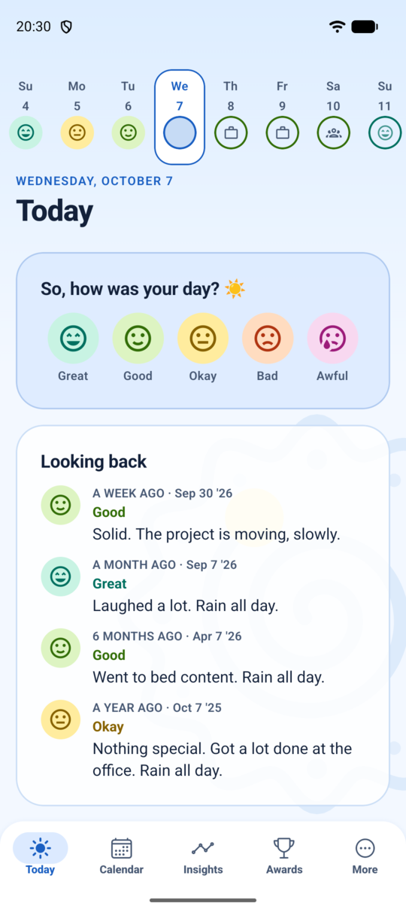
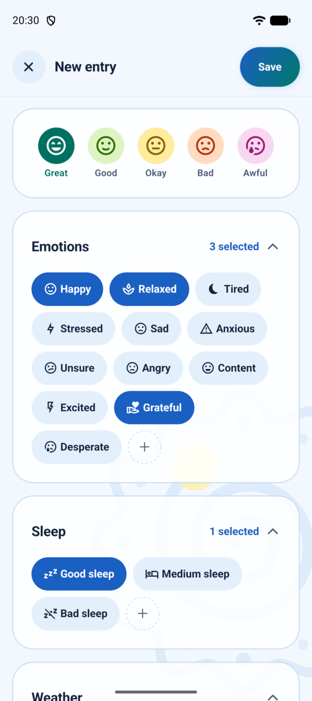
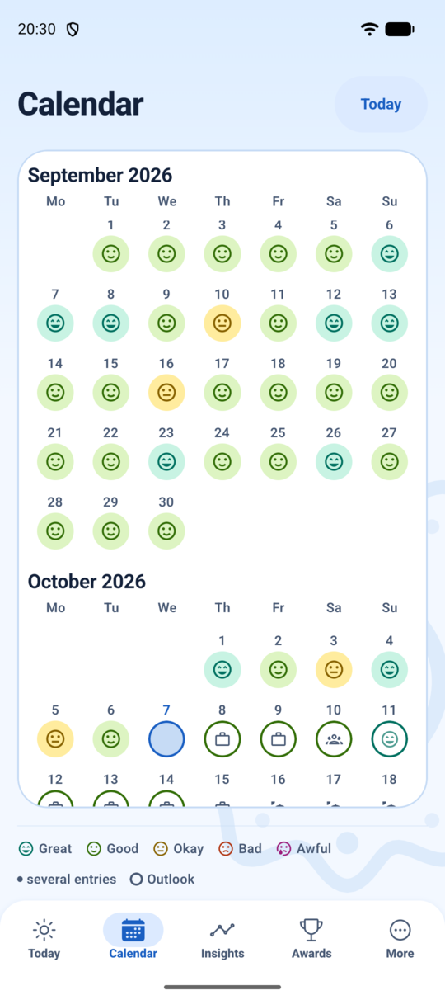
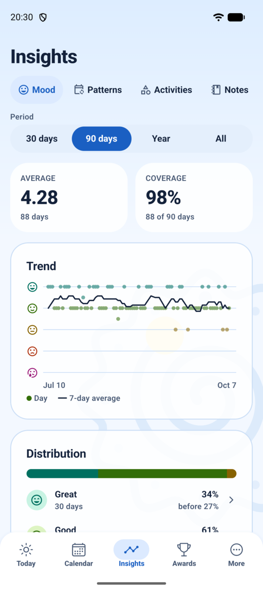
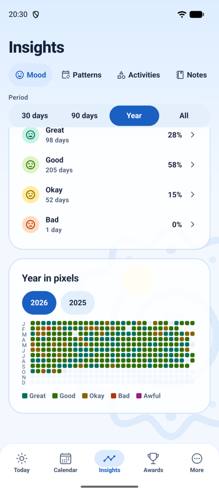
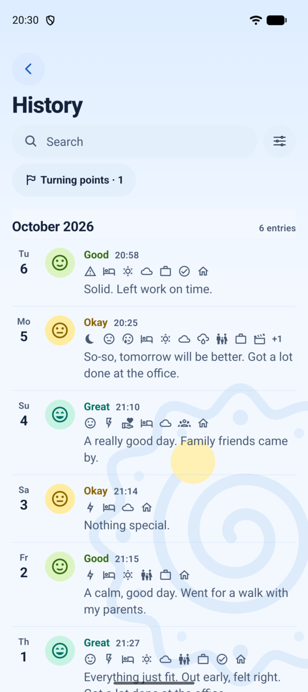
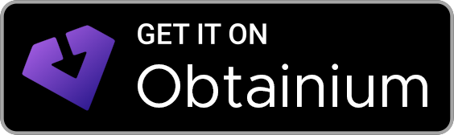

# Daylight

**English** | [Deutsch](README.de.md)

A mood journal for Android that doesn't know your data. No account, no servers, no analytics, no ads and no internet permission. Everything stays on your device.

<p align="center">
  
  
  
</p>
<p align="center">
  
  
  
</p>

<sub>All screenshots show the built-in sample data.</sub>

## Highlights

- 🔒 **Completely offline.** Daylight has no internet permission. Your entries live in a database on your device and only leave it when you share a backup yourself. The [Exodus Privacy report](https://reports.exodus-privacy.eu.org/en/reports/de.behla.daylight/latest/) finds no trackers in the Play version.
- ⚡ **Logged in seconds.** Tap a mood, pick what you did, done. A note, your own scales and a photo per day are optional.
- 📦 **Easy to switch.** Daylight imports an existing mood journal from another app completely, as a CSV export or as a backup with photos. You can export to CSV as well, and for your doctor or therapist there is a PDF report with mood, sleep, scales and activities, made on the device.
- 📊 **Insights into your patterns.** Trend, weekdays, months, year in pixels, which activities go along with better or worse days, what tends to follow the next day, frequent words in your notes. Always a description of your entries, never a diagnosis.
- 🌅 **Turning points.** Mark days that changed something, like a new job or a move, and compare the time before with the time after.
- 🧪 **Experiments.** Take something on for a few weeks, like no coffee after 2 pm, and see your entries before and during side by side. Daylight says honestly when there are too few days or the difference is within your usual ups and downs.
- 🏆 **Awards for keeping at it.** Stars for days and weeks in a row, for notes, photos, activities, sleep and steps. Only the journaling is rewarded, never how a day went.
- 🔭 **An honest outlook.** Daylight estimates the next seven days, but only where that measurably works better on your own data than simple guessing. Otherwise the outlook steps back and says so.
- ❤️ **Health data, if you want.** Steps, sleep, resting heart rate and exercise from Health Connect, for example from a smartwatch. Read only, and only after you agree.
- 🌙 **Dark mode for the evening.** A night blue scheme that follows your phone or stays light or dark, with mood colours and the year in pixels tuned for dark backgrounds. The seasonal designs come along.
- 🛡️ **Protected.** App lock with your device's screen lock, no screenshots while the lock is on, no Android cloud backup. The optional evening reminder reveals nothing from your journal.

The app is available in English, German, Spanish, Portuguese (Brazil), French, Italian, Dutch, Polish, Turkish and Indonesian.

## Install

The easiest way is [Google Play](https://play.google.com/store/apps/details?id=de.behla.daylight).

Without a Google account, use the APK attached to every [release](https://github.com/Jurgler95/daylight/releases/latest). Download it on your phone and open it; Android asks once whether your browser may install apps. The Play version and the APK are signed with the same key, so you can install one over the other.

To keep the APK up to date automatically, get it straight from the releases with [Obtainium](https://github.com/ImranR98/Obtainium):

[](https://apps.obtainium.imranr.dev/redirect?r=obtainium://app/%7B%22id%22%3A%22de.behla.daylight%22%2C%22url%22%3A%22https%3A%2F%2Fgithub.com%2FJurgler95%2Fdaylight%22%2C%22author%22%3A%22Paul%20Behla%22%2C%22name%22%3A%22Daylight%22%7D)

Every APK is signed with the same key. To check it, compare the SHA-256 fingerprint of the certificate (`apksigner verify --print-certs daylight-X.Y.Z.apk`):

```
9D:5E:FF:54:19:70:F6:09:85:7F:B6:F8:43:1C:E8:62:74:B4:6E:FB:2E:1B:56:A5:9B:63:CC:87:04:1F:C9:8A
```

Daylight is not a medical device and does not replace advice or treatment. If you have been feeling low for a while, please reach out to someone you trust or a local support line; [findahelpline.com](https://findahelpline.com/) lists free helplines by country.

## How it was built

Most of the code was written with an AI coding agent (Claude Code) under my direction. I decide what gets built, review and test every change and maintain the app.

## Development

Setup, architecture and the release process are described in [`docs/development.md`](docs/development.md) (German). I usually don't accept pull requests, but bug reports as issues are welcome, see [`CONTRIBUTING.md`](CONTRIBUTING.md).

## License

Copyright © 2026 Paul Behla, [paul-behla.de](https://paul-behla.de).

Daylight is free software under the [GNU General Public License, version 3 or later](LICENSE), with an additional term under section 7(b): anyone who distributes the app or a version based on it must keep the notice "Based on Daylight by Paul Behla (paul-behla.de)" visible in the app, for example on the About screen. The exact wording is in [`NOTICE`](NOTICE).
